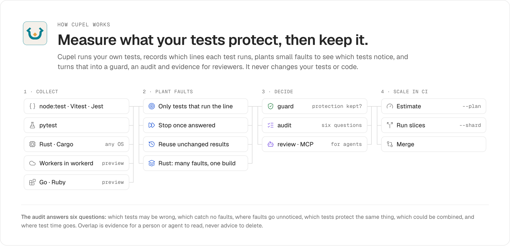

<p align="center">
  
</p>

<h1 align="center">Cupel</h1>

<p align="center">
  <strong>Know what your tests actually protect, and keep it when people or agents change them.</strong><br>
  MIT · version <code>0.4.0</code> · JavaScript & TypeScript · Python · Rust · Cloudflare Workers · Go and Ruby previews
</p>

<picture>
  <source media="(prefers-color-scheme: dark)" srcset="docs/assets/protection-dark.png">
  
</picture>

A passing suite can quietly stop protecting your code. An assertion gets weaker,
a refactor stops checking a boundary, or a generated test runs the right lines
without noticing the wrong behaviour. Coverage cannot see it; the tests stay green.

Cupel runs your own tests, records which lines each test runs, and plants small
faults in the code to see which tests notice. From that evidence it **guards**
changes (fail when protection is lost), **audits** the suite (six questions, one
report) and gives reviewers and agents the **evidence** behind each test. It never
changes or deletes your tests or code, makes no model calls, and has no telemetry:
its output is a signal for the people and agents who do the work.

## How it works

<picture>
  <source media="(prefers-color-scheme: dark)" srcset="docs/assets/how-it-works-dark.png">
  
</picture>

1. **Collect.** Run the supported test runner and attribute coverage to each test.
2. **Plant faults.** Change one small thing at a time (a `>` to `>=`, a return
   value) and record which tests fail. Only the tests that run that line are run,
   and results whose code and tests have not changed are reused.
3. **Decide.**
   - `guard --base <ref>` compares with an earlier commit and fails on lost
     coverage, a critical fault that is no longer caught, or a protected test
     removed without approval, even when every test still passes.
   - `audit` answers six questions: possibly wrong tests, tests that catch no
     faults, code whose faults go unnoticed, tests of the same thing, tests that
     could be combined, and where test time goes.
4. **Scale.** `cupel mutate --plan` estimates the work and suggests how many CI
   machines each runner needs; `--shard I/N` runs one slice and
   `merge-mutations` joins them.

## Quick start

You need Node **22+**, Git, and the project's own dependencies installed. pytest
also needs Python **3.12+** and the Python collector ([installation](docs/install.md));
Rust needs rustup's LLVM tools and, for fault testing, cargo-mutants.

Install the release package offline (download `vibernt-cupel-0.4.0.tgz` from the
[v0.4.0 release](https://github.com/Vibernt/cupel/releases/tag/v0.4.0)), or run
straight from a clone:

```sh
npm install --offline --ignore-scripts --no-audit --no-fund --prefix ~/.cupel ./vibernt-cupel-0.4.0.tgz
CUPEL=~/.cupel/node_modules/.bin/cupel

# or, from source
git clone https://github.com/Vibernt/cupel.git
CUPEL="node $PWD/cupel/packages/cupel/bin/cupel.mjs"
```

Then, in the Git root of the project you want to assess:

```sh
$CUPEL report                       # collect, plant faults, save .cupel/input.json
$CUPEL audit --input .cupel/input.json
$CUPEL guard --base HEAD            # after changing tests: is the protection still there?
```

Exit codes: `0` OK, `1` a guard or check failed, `2` invalid usage or input, `3`
an environment problem. Mark critical code and choose runners in `cupel.json`
([config guide](docs/extending/config.md)). Packages are not on npm or PyPI.

## Commands

| Command | What it does |
| --- | --- |
| `report`, `review` | Collect and plant faults; per-test coverage, catches, timing and review hints. |
| `audit` | One read-only report on six questions about the suite. |
| `guard --base <ref>` | Compare protection with an earlier commit; fail when it is lost. |
| `check <tests>` | What a new or changed test adds or loses. |
| `mutate --plan`, `--shard I/N`, `merge-mutations` | Plan fault testing, run one CI slice, join slices. |
| `label`, `plan`, `import`, `validate`, `mcp` | Tiers, test order, JUnit and cargo-mutants import, schema checks, the MCP server. |

The [CLI reference](docs/cli.md) has every option.

## Fast enough for every pull request

Fault testing is the slow part. Cupel saves time without guessing, and never
reports a fault as caught or missed when a full run would say otherwise:

- **Only relevant tests.** A fault runs only the tests whose coverage includes its
  line; a fault on a line no test runs is reported without running anything.
- **Stop once answered.** Most relevant and fastest first, stopping after two
  catches (enough to know whether one test is the only one). On pull requests,
  `guard` stops at the first catch: it only needs to know whether each fault was
  caught.
- **Reuse.** Results whose code, tests and test inputs are unchanged are copied
  from the last run (`.cupel/input.json` locally; `--reuse <file>` from your CI cache).
- **Rust, built for it.** `"backend": "cupel"` builds only the test targets that run
  the line and compiles many faults into one switchable build. On one critical
  file of a private Rust workspace (90 faults), fault testing took about 27 minutes
  as a pull-request guard and 60 with full results, against about 3 hours
  estimated for cargo-mutants; statuses were identical. Your times depend on your tests.
- **Slices.** When one machine is not enough, `mutate --plan` says how many, per runner.

[Faster fault testing](docs/speed.md) has the settings and CI recipes;
[best practices](docs/best-practices.md) covers what to run when and how to read
the results.

## What is supported

The [support matrix](docs/support.md) is the authoritative version and scope contract.

| Scope | Runners | Evidence and limits |
| --- | --- | --- |
| Core: full guard | `node:test`, Vitest, narrow Jest, pytest | Source and installed acceptance; exact runtime, loader and transform limits apply. |
| Preview | Rust/Cargo, Go, Ruby/Minitest | Fixture acceptance; Rust coverage matched plain LLVM line for line on a real workspace. Real-repository acceptance is not yet a recorded gate. |
| Preview | Worker code in workerd (node:test tests that start Miniflare, wrangler or workerd) | Per-test coverage and fault testing of Worker files workerd runs as they are; bundled or compiled Worker code is reported as not measured. |
| Experimental | Selective PR commands | Outside the supported first release; Node 26.7.0 profile only; Node 22 refuses. |
| Integration | MCP; GitHub Action wrapper | MCP is tested locally. Hosted required checks and branch protection are unverified. |

**Mixed-language repositories.** One `cupel.json` can name several runners; their
evidence merges into one report. Code another language's tests run, such as Rust
built into a WebAssembly module that Worker tests load, is labelled with those
tests (`builtInto`) instead of looking untested.

Real-repository Jest acceptance kept the original **51 tests in 4 files** and
caught all **11 planted critical faults**; weakening one assertion kept every test
passing and made the guard fail ([evidence](plans/results/2026-10-26-jest-acceptance.md)).
Linux and Windows are not verified for the 0.2–0.4 features.

## Use with an agent

```sh
$CUPEL mcp --root /absolute/path/to/your/project
```

Point your MCP client at that command. Agents read `cupel_review` and
`cupel_audit` before changing tests and run a fresh `cupel_guard` afterwards;
Cupel never creates the human approvals that removing a critical test needs.
[MCP setup](docs/mcp.md) covers Claude Code, Cursor and Codex.

## Honest limits

- Coverage says what ran and caught faults say what was noticed; neither says an
  expected value is right. That needs a person or a reviewer.
- A test with no unique coverage or catches is not proven redundant. Overlap is
  evidence to read, and Cupel never advises deleting a test.
- A passing guard covers the measured scope and rules, nothing more.

## Learn more

| | |
| --- | --- |
| [Docs index](docs/README.md) | Usage, runners, extension contracts and evidence. |
| [Best practices](docs/best-practices.md), [Faster fault testing](docs/speed.md) | What to run when; settings, reuse, slices and CI recipes. |
| [Rust](docs/rust.md), [workerd](docs/workerd.md), [Python](docs/python.md) | Runner details and limits. |
| [Release records](plans/results/2026-11-23-0.4.0-release.md) | What each version adds and what was verified ([0.3.0](plans/results/2026-11-23-0.3.0-release.md), [0.2.0](plans/results/2026-11-23-0.2.0-candidate.md), [first candidate](plans/results/2026-10-26-private-candidate.md), [history](docs/private-use.md#artifact-provenance)). |
| [CONTRIBUTING.md](CONTRIBUTING.md) | Checks, repository rules and [development tooling](docs/development.md). |

The README artwork is code: Fire components rendered by
`scripts/render-readme-art.mjs` ([sources](docs/assets/README.md)).

## Licence

First-party Cupel code is licensed under [MIT](LICENSE). See [NOTICE](NOTICE) for
attribution and third-party material. The source repository is public; package
registry publication is managed separately.
