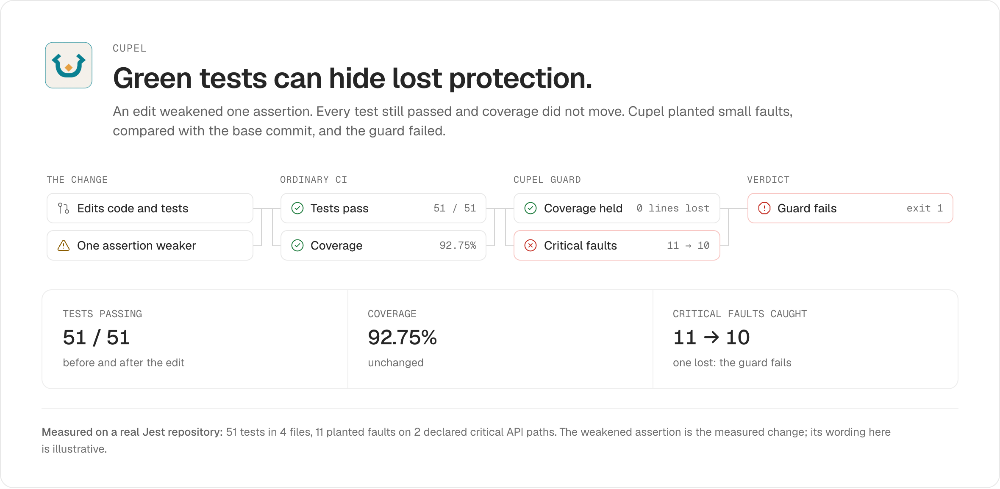

<p align="center">
  
</p>

<h1 align="center">Cupel</h1>

<p align="center">
  <strong>Know what your tests actually protect, and keep it when people or agents change them.</strong>
</p>

<p align="center">
  MIT · version <code>0.5.2</code> · zero dependencies · JavaScript & TypeScript · Python · Rust · Go · Ruby · Cloudflare Workers
</p>

<p align="center">
  <a href="https://vibernt.github.io/cupel/">Documentation</a> ·
  <a href="#quick-start">Quick start</a> ·
  <a href="#how-it-works">How it works</a> ·
  <a href="#fast-enough-for-every-pull-request">Speed</a> ·
  <a href="#languages">Languages</a> ·
  <a href="https://github.com/Vibernt/cupel/releases">Releases</a>
</p>

<picture>
  <source media="(prefers-color-scheme: dark)" srcset="docs/assets/protection-dark.png">
  
</picture>

A passing suite can quietly stop protecting your code. An assertion gets weaker, a
refactor stops checking a boundary, or a generated test runs the right lines without
noticing the wrong behaviour. Coverage cannot see it, and the tests stay green.

Cupel runs **your own tests**, records which lines each test runs, then plants small
faults in the code (a `>=` becomes `>`, a `&&` becomes `||`) and records which tests
notice. That evidence lets it **guard** a change (fail when protection is lost),
**audit** a suite, and show reviewers and agents what each test is worth. It never
changes or deletes your tests or code, makes no model calls, sends nothing off your
machine, and has no dependencies and no telemetry.

## See it

A two-test project with 100% line coverage. `cupel report` plants 10 faults and two
of them go unnoticed:

```console
$ cupel report
cupel: run 1/2 (coverage): 2 tests, 2 passed, 0.1 s
cupel: run 2/2 (coverage): 2 tests, 2 passed, 0.1 s
cupel: mutate: 10 valid, 0 invalid, 10 run with 5 processes
2 tests, 2 units, coverage 100% (4/4), mutation score 80%

$ cupel audit --input .cupel/input.json
Code that runs but where a fault went unnoticed:
- `src/price.mjs` lines 2
  - line 2: src/price.mjs:2:27:logical:928cbdab
  - line 2: src/price.mjs:2:36:boundary:2ec6ba8b
```

Now weaken one assertion, from `equal(…, 90)` to `ok(… > 0)`. Every test still
passes and coverage is unchanged, but the guard sees what was lost:

```console
$ cupel guard --base HEAD
pass  head-passes
pass  coverage-ratio  100% -> 100%
FAIL  critical-mutation  lost mutants src/price.mjs:2:14:cmp-flip:fcf391f9, …
guard failed                                              # exit code 1
```

(Real output from Cupel 0.5.0, shortened.)

## Quick start

You need Node **22+** and Git, with the project's own dependencies installed (pytest
projects also need Python **3.12+** and the Python collector). Download
`vibernt-cupel-0.5.2.tgz` from the [v0.5.2 release](https://github.com/Vibernt/cupel/releases/tag/v0.5.2)
and install it offline:

```sh
npm install --offline --ignore-scripts --no-audit --no-fund --prefix ~/.cupel ./vibernt-cupel-0.5.2.tgz
alias cupel=~/.cupel/node_modules/.bin/cupel
```

Then, in the Git root of the project you want to assess:

```sh
cupel report                          # collect coverage, plant faults, save .cupel/input.json
cupel audit --input .cupel/input.json # six questions about the suite, one report
cupel guard --base main               # in a pull request: is the protection still there?
```

Mark the code that matters in `cupel.json` (`{ "tiers": { "critical": ["src/billing/**"] } }`).
Exit codes: `0` ok, `1` a guard or check failed, `2` invalid usage, `3` an environment
problem. Running from a clone, pytest's collector, Rust's tools and the other options are in
[Installation](https://vibernt.github.io/cupel/install.html). The packages are not on npm or PyPI.

## What you get

- **A guard for every change.** `guard --base <ref>` fails on lost coverage, a critical
  fault that is no longer caught, or a protected test removed without approval, even
  when every test passes. [Guide](docs/private-use.md)
- **An audit of the suite.** Possibly wrong tests, tests that catch nothing, code whose
  faults go unnoticed, tests of the same thing, tests that could be combined, and where
  the time goes. [Best practices](docs/best-practices.md)
- **Evidence for each test.** Lines it runs, faults it alone catches, overlap, and review
  hints (`cupel review`, `cupel check <tests>`). [CLI reference](docs/cli.md)
- **Built for agents.** A local MCP server gives coding agents the same evidence before
  and after they edit tests; Cupel never creates the human approvals a critical test's
  removal needs. [MCP setup](docs/mcp.md)
- **Many languages, one report.** JavaScript and TypeScript, Python, Rust, Go, Ruby and
  Worker code in workerd; one `cupel.json` merges them. [Support matrix](docs/support.md)
- **Fast enough for pull requests**, without guessing (below). [Faster fault testing](docs/speed.md)
- **Deterministic and offline.** The same input gives the same result; nothing leaves
  your machine.

## How it works

<picture>
  <source media="(prefers-color-scheme: dark)" srcset="docs/assets/how-it-works-dark.png">
  
</picture>

1. **Collect.** Run your test runner and attribute coverage to each test.
2. **Plant faults.** Change one small thing at a time and record which tests fail. A
   fault that a test catches is *caught*; one that no test notices is *unnoticed*, and
   points at a weak spot.
3. **Decide.** Guard a change, audit the suite, or hand the evidence to a reviewer or agent.
4. **Scale.** Estimate the work, split it across CI machines and merge the slices.

## Fast enough for every pull request

Fault testing is the slow part. Cupel saves time only where the answer is already
known, so a fault is never reported caught or unnoticed when running it fully would say
otherwise:

- **Only the tests that run the line.** A fault on a line no test runs is reported
  without running anything.
- **Likely catchers first, stop once answered.** Tests that caught the fault last time,
  then the tests written for its own file; stop after two catches, or one in a
  pull-request guard.
- **Reuse.** Answers whose code, tests and test inputs are unchanged are copied from the
  last run.
- **One build for many faults.** Rust and Go compile many faults into one switchable
  build; Rust keeps it between runs, so an unchanged project starts in seconds.
- **Slices for CI.** `mutate --plan` says how many machines each runner needs; Rust can
  prepare its build once and share it with every slice.

Measured on one machine (Apple silicon, macOS); your times depend on your tests:

| Workload | Before | With Cupel 0.5.0 |
| --- | --- | --- |
| Private Rust workspace, one critical file, 89 faults, pull-request guard | 27 min (Cupel 0.4.0) | 21 min with the build kept; setup 527 s → 5 s when nothing changed; fault tests 1,272 s → 584 s |
| Second Rust workspace (sqlx, tokio), 56 faults | 138 s (cargo-mutants) | 42 s cold, 26 s warm, identical results |
| Go test fixture | one build per fault | 3.9 s → 2.8 s, `go test -c` calls 4 → 1, identical results |

Every switched Rust fault in that workspace (75 of 89) agreed with its own separate
build in a verification run. Method and raw numbers: the
[0.5.0 release record](plans/results/2026-11-25-0.5.0-release.md).

## Languages

| Language (runner) | Support | Only covering tests | Likely catchers first, early stop | One build for many faults | Reuse | Verified on |
| --- | --- | --- | --- | --- | --- | --- |
| JavaScript / TypeScript (node:test, Vitest, Jest) | Core | Yes | Yes | Not needed | Yes | Fixtures; a real Jest repository (51 tests, 11 of 11 critical faults caught) |
| Python (pytest) | Core | Yes | Yes | Not needed | Yes | Fixtures |
| Rust (Cargo) | Preview | Yes | Yes | Yes, kept between runs | Yes | Fixtures; two real workspaces |
| Go | Preview | Yes | Yes | Yes | Yes, guarded | Fixtures (Go 1.27.1) |
| Ruby (Minitest) | Preview | Yes | Yes | Not needed | Not yet | Fixtures (MRI 4.0.7) |
| Worker code in workerd | Preview | Yes | Not verified | Not needed | Not verified | A private Workers codebase |

*Core* runs the full guard with installed acceptance; a *preview* is bounded to the
documented profile. The [selective PR commands](docs/selective-pr.md) are experimental:
a Node 26.7.0 profile outside the supported first release. macOS only so far: Linux and Windows are not verified. The
[support matrix](docs/support.md) is the authoritative contract, and each runner has its
own page: [Vitest](docs/vitest.md), [Jest](docs/jest.md), [Python](docs/python.md),
[Rust](docs/rust.md), [Go](docs/go.md), [Ruby](docs/ruby.md), [workerd](docs/workerd.md).

## With coding agents

```sh
cupel mcp --root /absolute/path/to/your/project
```

Point Claude Code, Cursor or Codex at that command. Agents read `cupel_review` and
`cupel_audit` before changing tests and run a fresh `cupel_guard` afterwards.
[MCP setup](docs/mcp.md)

## Honest limits

- Coverage says what ran and caught faults say what was noticed; neither says an
  expected value is right. That still needs a person or a reviewer.
- A test with no unique coverage or catches is not proven redundant. Cupel never advises
  deleting a test.
- A passing guard covers the measured scope and rules, nothing more.
- Fault testing costs time on large suites: mark few files critical and use
  changed-lines mode on pull requests ([best practices](docs/best-practices.md)).
- Flaky tests make any fault result unreliable; Cupel reports instability it sees but
  cannot fix it.

## Documentation

The full documentation is at **[vibernt.github.io/cupel](https://vibernt.github.io/cupel/)**
and in [`docs/`](docs/README.md): installation, guides, CI recipes, every runner, the CLI
and config reference, and the extension contracts. What each version adds and what was
verified is in the [release records](plans/results/2026-11-27-0.5.2-release.md); design
decisions are in [`plans/DECISIONS.md`](plans/DECISIONS.md).

## Contributing

Issues and pull requests are welcome. [CONTRIBUTING.md](CONTRIBUTING.md) covers the checks
and repository rules, and [development](docs/development.md) the tooling. The README
diagrams are code: [Fire](https://github.com/vidhatanand/firedesign) components rendered by
`scripts/render-readme-art.mjs` ([sources](docs/assets/README.md)).

## Licence

[MIT](LICENSE). See [NOTICE](NOTICE) for attribution and third-party material.
